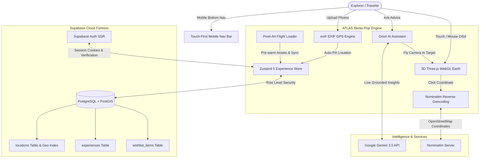

# 🌍 ATLAS — The Living 3D Digital Cartography of Your Life

```
    ___  _____ _      ___  ____  
   / _ \/__   \ |    / _ \/ ___| 
  / /_\ \ / /\/ |   / /_\ \___ \ 
 / /   \// /  | |__/ /   \ \__) |
 \/    \/\_/   |_____\/   \_____/ 
 A Living, Gamified 3D Cartography of Your Life
```

<p align="center">
  <a href="https://atlas-app-ruby-six.vercel.app/globe">
    
  </a>
  
  
  
  
  
  
</p>

<p align="center">
  <b>🌐 Live Production Deployment:</b> <a href="https://atlas-app-ruby-six.vercel.app/globe"><b>https://atlas-app-ruby-six.vercel.app/globe</b></a>
</p>

<p align="center">
  <a href="https://vercel.com/new/clone?repository-url=https%3A%2F%2Fgithub.com%2Fiamnih4l%2FATLAS&root-directory=atlas-app">
    
  </a>
</p>

> *"Every mountain you conquer, every alleyway café in Kyoto, and every midnight train across Europe isn't just a fleeting social media post. It is a coordinate on the spinning Earth. It is a chapter in the atlas of your life."*

---

## 🧭 Interactive Compass — Choose Your Path

<details open>
<summary><b>📖 Prologue: The Story Behind ATLAS (Click to collapse/expand)</b></summary>
<br />

Remember spinning an old physical globe in a sunlit classroom as a kid? Placing your finger on an archipelago across the ocean and whispering, *"One day, I will stand there."*

In modern life, our memories are scattered: lost inside algorithms that optimize for likes, buried under thousands of unorganized camera roll snapshots, or forgotten in text threads. 

**ATLAS brings back the romanticism of the personal journal.** It combines the archival prestige of Letterboxd with a tactile, gamified 3D Earth. Every milestone you record is pinned to real WGS84 geographic coordinates, preserved with half-star precision, and protected by end-to-end database security.

And when you wonder where to go next? **Orion**, your AI celestial expedition companion, reads the patterns in your past adventures and charts your next horizon.

</details>

<details>
<summary><b>🕹️ The Explorer's Guide (How the app works)</b></summary>
<br />

- **Spin & Zoom the 3D Earth**: WebGL rendered at 60 FPS with tactile inertia damping.
- **Drop Pins with 1 Click**: Click anywhere on continents or oceans — Nominatim reverse-geocodes the exact city and country in real time.
- **Auto-Extract GPS from Photos**: Drop a camera photo and let `exifr` detect the exact latitude, longitude, camera model, and capture date.
- **Consult Orion (AI Travel Companion)**: Chat in real time with an AI that knows your travel history and gives grounded recommendations.
- **Cinematic Pixel-Art Loader**: Watch a retro pixel aeroplane navigate across the globe while your personal coordinates and assets sync.
- **Touch-First Mobile Experience**: Dedicated bottom navigation bar with 48px+ touch targets and adaptive drawers.
- **One-Click Wishlist Conversion**: Turn dream destinations into completed memories when you return from your journey.

</details>

<details>
<summary><b>⚡ The Engineer's Blueprint (Architecture & Stack)</b></summary>
<br />

- **Frontend**: Next.js 16 (App Router, Turbopack, React 19), Tailwind CSS v4, Framer Motion, Lucide Icons.
- **3D Engine**: Three.js WebGL canvas with custom daylight gamified pop shaders, atmospheric Rayleigh glow, and Cartesian WGS84 spherical coordinate projections.
- **State Management**: Zustand 5 with local offline persistence and optimistic UI updates.
- **Authentication**: Supabase Auth with `@supabase/ssr` cookies, session recovery, email confirmation workflows, and Guest Explorer mode.
- **Artificial Intelligence**: Google Gemini API (`gemini-3.5-flash-lite`) powering conversational travel advice and structured JSON coordinate suggestions.
- **Cloud Database**: Supabase PostgreSQL 15 + PostGIS spatial geography indexing + Row Level Security (RLS) policies enforcing `auth.uid() = user_id`.

</details>

---

## 🗺️ System Architecture



---

## 🌟 The Seven Chronicles of ATLAS

### 🌍 Chapter I: The Living 3D Globe (`/globe`)
- **60 FPS Tactile Orbit**: Built on custom Three.js shaders with atmospheric Rayleigh scattering, warm Bento-Pop landmasses, and zero clutter.
- **Dual-Marker Cartography**:
  - 🟢 **Emerald Pins (`#10b981`)**: Visited milestones, stamped into reality.
  - 🟣 **Violet Pulsing Markers (`#8b5cf6`)**: Whispers of the future — your active travel bucket list.
- **Spatial Multi-Tenancy**: Visit Niagara Falls for a freezing boat tour in 2021, and return for a helicopter flight in 2025. Both memories comfortably share the exact physical coordinate without overwriting history.
- **Fly-to-Target Navigation**: Click any city, pin, or recommendation card to swoosh the 3D camera across oceans at cinematic speed.

---

### ✈️ Chapter II: Cinematic Pixel-Art Loading Experience (`/loading`)
- **Postcard Flight Manifest**: An original pixel-art scene between authentication and the globe.
- **Handcrafted Pixel Aeroplane**: A custom 16×16 pixel plane sprite that banks and tilts dynamically along a curved, dotted flight path (`stroke-dasharray="6 6"`).
- **Progressive Milestones**: Floating pixel clouds, pop-up milestone pins, and rotating travel postcards:
  - *"PREPARING YOUR ATLAS..."*
  - *"CHARTING YOUR WORLD..."*
  - *"GATHERING YOUR MEMORIES..."*
  - *"GETTING YOUR GLOBE READY..."*
  - *"YOUR NEXT ADVENTURE AWAITS..."*
- **Real Functional Synchronization**: Verifies auth session, populates stored journals, and pre-warms 3D textures with timeout protection.

---

### 📱 Chapter III: Touch-First Mobile Experience
- **Dedicated Mobile Navigation (`MobileBottomNav`)**: Fixed thumb-friendly bottom bar on mobile screens (`< 640px`) with 48px+ touch targets for **Globe**, **Memories**, Center Prominent **Record (+)**, **Discover**, and **Wishlist**.
- **Compact Top HUD**: Streamlined brand emblem, spotlight search trigger (`⌘K`), and settings access without viewport clutter.
- **Adaptive Location Drawer**: Responsive slide-up card sheet on mobile viewports (320px–414px) that keeps the 3D canvas interactive.
- **Mobile-Tuned Controls**: Horizontally scrolling category pills and floating companion placement optimized for handheld usage.

---

### 📸 Chapter IV: The Chronicler's Quill (`/memories` & EXIF Magic)
- **Instant Photo Geocoding**: Drop a vacation photo from your smartphone. `exifr` extracts embedded GPS coordinates, camera hardware, and timestamps:
  > *"📍 GPS detected in photo! Found: Eiffel Tower, Paris (48.8584° N, 2.2945° E). Confirm and apply location?"*
- **Letterboxd-Style Half-Star Precision**: Rate memories from `⭐ 0.5` to `⭐⭐⭐⭐⭐ 5.0` with custom half-star hovering.
- **15 Curated Travel Categories**: *Adventure, Nature, Food & Dining, Travel, Sports, Entertainment, Culture, Architecture, Wildlife, Photography, Spiritual, Family, Hidden Gem, Transit, Other.*
- **Vault Privacy**: Control visibility per experience — `Private` (only you), `Unlisted` (shareable link), or `Public`.

---

### 🌌 Chapter V: Orion — The AI Celestial Companion (`/discover`)
Orion is not a sterile chatbot. Powered by **Google Gemini**, Orion acts as your charismatic expedition navigator:

```text
Explorer: "I loved skydiving in Dubai, what's my next thrill?"
Orion: "Since you rated tandem freefall 5.0, your next horizon is Interlaken, 
        Switzerland! Glide from the alpine meadows of Beatenberg at 1,350m over 
        turquoise Lake Thun with the towering Eiger directly ahead."
```

- **Next Horizon Mode**: Identifies natural progressions in your adventurous tastes.
- **Proximity Radar Mode**: Locates hidden spots within striking distance of your current location.
- **Bucket List Architect**: Crafts rich itineraries from vague travel daydreams.
- **In-App Bento Details Modal**: Safely explore recommendations inside ATLAS with verified coordinates, sensory overviews, Orion's curated reasoning, and safe Google Maps lookup.

---

### ⏳ Chapter VI: The Traveler's Ledger (`/timeline` & `/statistics`)
- **The Winding Road Timeline**: Visual chronological milestone badges mapping your life by year and season.
- **Raw True Analytics**: No vanity metrics. Real computing over your PostgreSQL ledger:
  - Total countries stamped & cities claimed.
  - Interactive Recharts breakdown: rating distribution, top visited countries, and category donuts.
  - Bucket list completion ratio (Dreamt vs. Conquered).

---

### 🛡️ Chapter VII: The Cloud Fortress (Supabase & PostGIS)
- **Zero-Trust Row Level Security (RLS)**: Enforced directly at the PostgreSQL layer via `auth.uid() = user_id`.
- **Dual-Env Hybrid Authentication**: Uses `@supabase/ssr` with persistent session cookies, email verification workflows, and password visibility toggles (`PasswordInput`).
- **Guest Explorer Mode**: Instant exploration without mandatory sign-in, with local caching and seamless cloud synchronization upon account creation.
- **Public Isolation**: System tables like `spatial_ref_sys` have all public API grants revoked — external visitors cannot query or tamper with internal projection tables.

---

## 🏆 Traveler's Achievement Roster

Can you unlock all badges on your ATLAS passport?

| Badge | Title | Requirement |
|:---:|---|---|
| 🎒 | **The First Step** | Record your very first travel memory |
| 🦅 | **High-Altitude Dreamer** | Log an Adventure category experience rated 5.0 |
| 🧭 | **Continent Hopper** | Place pins across 3 or more distinct continents |
| 📸 | **Digital Archaeologist** | Auto-detect coordinates using photo EXIF GPS |
| 🌌 | **Orion's Protégé** | Ask Orion for advice and save a recommendation to your Wishlist |
| 🎯 | **Dream Realized** | Convert a bucket list item into a completed memory with "Done! Record It" |
| 👑 | **Grand Cartographer** | Map 25 or more verified coordinates on the 3D globe |

---

## 🚀 Quickstart — Run ATLAS in 60 Seconds

### 1. Clone the Vessel
```bash
git clone https://github.com/iamnih4l/ATLAS.git
cd ATLAS/atlas-app
```

### 2. Install Dependencies
```bash
pnpm install
```

### 3. Configure Your Environment
Create `atlas-app/.env.local`:
```ini
# Supabase Cloud Database (Required for cloud sync)
NEXT_PUBLIC_SUPABASE_URL=https://your-project.supabase.co
NEXT_PUBLIC_SUPABASE_ANON_KEY=your-anon-key
SUPABASE_URL=https://your-project.supabase.co
SUPABASE_PUBLISHABLE_KEY=your-publishable-key
SUPABASE_SECRET_KEY=your-secret-key

# Google Gemini AI (Powers Orion Travel Companion)
AI_PROVIDER=google
AI_MODEL=gemini-3.5-flash-lite
AI_API_KEY=your-gemini-api-key
GEMINI_API_KEY=your-gemini-api-key
```

*(Note: ATLAS runs out-of-the-box in local guest mode even before connecting cloud keys!)*

### 4. Initialize Database
Execute the migrations in your Supabase SQL Editor:
1. `atlas-app/supabase/migrations/00001_initial_schema.sql` (Creates all 11 tables, categories & PostGIS indexes)
2. `atlas-app/supabase/migrations/00002_secure_spatial_ref_sys.sql` (Secures PostGIS system tables)

### 5. Launch the Expedition
```bash
pnpm dev
```
Open **[http://localhost:3000](http://localhost:3000)** in your browser, pick a spot on Earth, and begin mapping your story!

---

## 🎒 The Explorer's Secret Field Log & Easter Eggs

> *"The world is too big to stay in one place, and too small to ever lose your way."* — **Pip the Scout 🎒**

```
 ____________________________________________________________________
|  ✈️  ATLAS OFFICIAL EXPEDITION DISPATCH                           |
|  "WANDER OFTEN. WONDER ALWAYS."                   ┌─────────────┐  |
|                                                   │  [★ ATLAS ] │  |
|  To: Any Curious Wanderer                         │  [ AIRMAIL] │  |
|  From: Orbit (Altitude 400 km)                    └─────────────┘  |
|  Status: Daylight Earth Online ☀️                                  |
|  Destination: Wherever your heart beats faster.                    |
|____________________________________________________________________|
```

### 🗺️ Mystery Coordinates (Search or Fly to These in ATLAS!)
Paste or search these exact locations in Spotlight Search (`⌘K` or the top Search pill) to trigger special viewpoints & Orion notes:

- 🗻 **Mount Fuji Sunrise Ridge, Japan** — `35.3606° N, 138.7274° E`  
  *Tip: The 3D camera locks directly into the volcanic rim above the sea of clouds.*
- 🪂 **The Palm Jumeirah Dropzone, Dubai** — `25.1124° N, 55.1390° E`  
  *Pip says: "Whoa, Dubai! Are we jumping out of an airplane today?! 🪂☀️"*
- 🌌 **Reykjavík Aurora Fjord, Iceland** — `64.1466° N, 21.9426° W`  
  *Where green solar winds dance over black volcanic beaches.*
- 🗿 **Ahu Tongariki, Rapa Nui (Easter Island)** — `-27.1258° S, -109.2774° W`  
  *Fifteen monolithic stone giants facing inward toward the sunrise over the Pacific.*
- 🌊 **Osprey Reef Outer Wall, Australia** — `-16.8500° S, 146.2000° E`  
  *Ancient coral bommies glowing with nocturnal bioluminescent plankton under UV dive torches.*
- 🏔️ **Matterhorn Hörnli Ridge, Switzerland** — `45.9763° N, 7.6586° E`  
  *The pyramid peak that inspired countless chocolate bars and mountaineering legends.*

---

### 🎒 Pip's Golden Rules of Travel
1. **Always take the window seat.** The Earth looks infinitely cooler when you can watch coastlines curve below you.
2. **Follow the grandmothers.** If a street stall in Hanoi or Oaxaca has a line of local matriarchs waiting, join that queue immediately without asking questions.
3. **Drop the pin before you leave.** That tiny hole-in-the-wall jazz bar in Tokyo? You *will* forget its name tomorrow unless you log it in your ATLAS journal right now.
4. **Half-stars exist for a reason.** That 4.5-star ramen joint was life-changing, but the plastic stool broke halfway through? Half-star precision honors the truth.
5. **A passport is a sketchbook, not a museum relic.** Let it get coffee-stained, dog-eared, and overflowing with stamps.

---

### 🧭 The Great Wanderer's Quest Checklist
Are you a true cartographer? Check off these expeditions in your journal:

- [ ] **First Coordinate**: Drop your very first memory pin on your hometown.
- [ ] **Photo Time Machine**: Upload a raw photo from your camera roll and let `exifr` detect the GPS automatically.
- [ ] **Orion's Challenge**: Ask Orion for a recommendation that pushes you outside your comfort zone.
- [ ] **Midnight Dream**: Pin a destination across an ocean to your Wishlist in pulsing violet.
- [ ] **The Full Orbit**: Spin the 3D Earth with a flick of your finger on mobile and watch the continents blur.
- [ ] **The Circle Closes**: Return from an expedition and tap *"Done! Record It"* to convert a dream into a golden memory.

---

## 📜 Epilogue

> *"Twenty years from now you will be more disappointed by the things that you didn't do than by the ones you did do. So throw off the bowlines. Sail away from the safe harbor. Catch the trade winds in your sails. Explore. Dream. Discover."*  
> — **Mark Twain**

**Built with passion by Nihal & the ATLAS team.**  
*Live at [https://atlas-app-ruby-six.vercel.app/globe](https://atlas-app-ruby-six.vercel.app/globe)*
