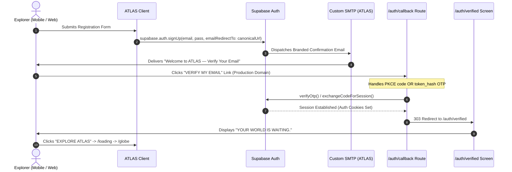

# ATLAS — Authentication Branding, Custom SMTP & URL Configuration Guide

This document outlines the exact settings required in the **Supabase Dashboard** and **Domain DNS** to deliver branded ATLAS verification emails and ensure verification links bypass Vercel developer gates.

---

## 1. Supabase URL Configuration (CRITICAL FOR ISSUE #2)

To prevent users from being redirected to localhost or to Vercel preview environments with Deployment Protection:

1. Open your **[Supabase Project Dashboard](https://supabase.com/dashboard/project/qzcmtvrkxnbtdqaipvcx)**.
2. Navigate to **Authentication** &rarr; **URL Configuration**.
3. Set **Site URL** to:
   ```text
   https://atlas-app-ruby-six.vercel.app
   ```
4. In **Redirect URLs (Allowlist)**, add the following entries:
   ```text
   https://atlas-app-ruby-six.vercel.app/**
   https://atlas-app-ruby-six.vercel.app/auth/callback
   https://atlas-app-ruby-six.vercel.app/api/auth/callback
   http://localhost:3000/**
   http://localhost:3000/auth/callback
   ```
5. Click **Save Changes**.

---

## 2. ATLAS-Branded Email Templates (CRITICAL FOR ISSUE #1)

Supabase by default uses generic unbranded emails. ATLAS provides fully responsive, inline-styled Bento-Pop HTML email templates.

### A. Confirm Signup Template
1. In Supabase Dashboard, navigate to **Authentication** &rarr; **Email Templates** &rarr; **Confirm signup**.
2. **Subject:**
   ```text
   ✦ Confirm your ATLAS Passport — Welcome Explorer
   ```
3. **Message Body:**
   Copy the full contents of:
   [`supabase/templates/confirm_signup.html`](file:///c:/Users/nihal/OneDrive/Desktop/ATLAS/atlas-app/supabase/templates/confirm_signup.html)
4. Click **Save**.

### B. Reset Password Template
1. In Supabase Dashboard, navigate to **Authentication** &rarr; **Email Templates** &rarr; **Reset password**.
2. **Subject:**
   ```text
   🔑 Reset your ATLAS Password
   ```
3. **Message Body:**
   Copy the full contents of:
   [`supabase/templates/reset_password.html`](file:///c:/Users/nihal/OneDrive/Desktop/ATLAS/atlas-app/supabase/templates/reset_password.html)
4. Click **Save**.

---

## 3. Custom SMTP Provider & Sender Identity

By default, Supabase sends from `noreply@mail.app.supabase.io` with a strict limit of 3 emails/hour. To send directly as **ATLAS** (e.g. `accounts@yourdomain.com` or `noreply@yourdomain.com`):

### A. Supabase Dashboard SMTP Settings
1. Navigate to **Project Settings** &rarr; **Authentication** &rarr; **SMTP Settings**.
2. Toggle **Enable Custom SMTP** to **ON**.
3. Fill in your SMTP provider details:
   - **Sender email:** `accounts@yourdomain.com` (or your verified domain email)
   - **Sender name:** `ATLAS` (or `ATLAS Authentication`)
   - **Host:** (e.g., `smtp.resend.com` / `smtp.sendgrid.net` / `smtp.postmarkapp.com`)
   - **Port:** `465` (SSL) or `587` (TLS)
   - **Username:** (from your provider)
   - **Password / API Key:** (from your provider)
4. Click **Save**.

### B. Domain DNS Authentication (SPF, DKIM, DMARC)
Ensure your domain's DNS manager (e.g., Cloudflare, Namecheap, Route 53) has the following TXT/CNAME records:

1. **SPF (Sender Policy Framework)**:
   ```text
   Type: TXT
   Name: @
   Value: v=spf1 include:amazonses.com ~all   (replace with your provider, e.g. include:resend.com)
   ```
2. **DKIM (DomainKeys Identified Mail)**:
   Add the 2-3 `CNAME` records provided by your SMTP service.
3. **DMARC (Domain-based Message Authentication)**:
   ```text
   Type: TXT
   Name: _dmarc
   Value: v=DMARC1; p=none; rua=mailto:dmarc-reports@yourdomain.com
   ```

---

## 4. Verification Flow Architecture


